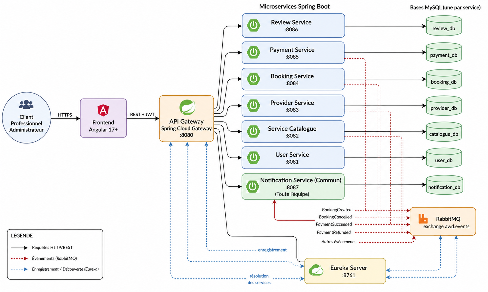

# RE’SERV — Plateforme de réservation de prestations de services

Projet AWD (ESPRIT) — équipe **The Mentalists**.

RE’SERV met en relation des **clients** et des **prestataires professionnels** : consultation des prestations, réservation en ligne, paiement, remboursement, avis et notifications. Le projet repose sur une **architecture microservices** (Spring Boot, API Gateway, Eureka, RabbitMQ, MySQL, Docker) avec un frontend Angular.

## Équipe et microservices

| Membre | Microservice |
|---|---|
| Aymen Fkir | User Service |
| Khadija Bessais | Service Catalogue |
| Rayen Sayari | Provider Service |
| Emna Jbari | Booking Service |
| Youssef Gomri | Payment Service |
| Fares Ben Kheder | Review Service |
| Toute l'équipe | Notification Service (microservice commun) |

## Architecture

<p align="center"></p>

| Composant | Port |
|---|---|
| API Gateway | 8080 |
| User Service | 8081 |
| Service Catalogue | 8082 |
| Provider Service | 8083 |
| Booking Service | 8084 |
| Payment Service | 8085 |
| Review Service | 8086 |
| Notification Service (commun) | 8087 |
| Eureka Server | 8761 |

## Structure du dépôt

```text
awd-platform/
├── backend/
│   ├── discovery-server/
│   ├── api-gateway/
│   ├── user-service/
│   ├── catalogue-service/
│   ├── provider-service/
│   ├── booking-service/
│   ├── payment-service/
│   ├── review-service/
│   └── notification-service/
├── frontend/
│   └── angular-app/
├── docs/
│   ├── rapport/          # Document technique (Markdown et Word)
│   ├── presentation/     # Présentation de la séance 4
│   └── diagrammes/       # Diagrammes (images et sources Mermaid)
└── README.md
```

## Documentation

- [Document technique complet](docs/rapport/Rapport_Technique.md) (version Word : `docs/rapport/Rapport_Technique_RESERV.docx`)
- Présentation de la séance 4 : `docs/presentation/`
- Diagrammes : [`docs/diagrammes/`](docs/diagrammes/)

## Stack technique

Java 17 · Spring Boot · Spring Cloud Gateway · Eureka · Spring Security (JWT) · REST · RabbitMQ · MySQL · Docker / Docker Compose · Angular 17+ · Git / GitHub · Postman.

## Gestion de projet

GitHub Projects (tableau Kanban : À faire, En cours, En revue, Terminé), branches Git et Pull Requests, itérations d'une semaine.
