<h1 align="center">RE’SERV</h1>
<p align="center"><strong>Plateforme de réservation de prestations de services</strong></p>
<p align="center">Document technique — Validation intermédiaire (Semaine 4)<br>Module AWD · ESPRIT · Équipe The Mentalists · Novembre 2026</p>

## Équipe

| Membre | Microservice |
|---|---|
| Aymen Fkir | User Service |
| Khadija Bessais | Service Catalogue |
| Rayen Sayari | Provider Service |
| Emna Jbari | Booking Service |
| Youssef Gomri | Payment Service |
| Fares Ben Kheder | Review Service |
| Toute l'équipe | Notification Service (microservice commun) |

## Sommaire

- [1. Présentation du projet](#1-présentation-du-projet)
  - [1.1 Contexte et idée générale](#11-contexte-et-idée-générale)
  - [1.2 Problématique](#12-problématique)
  - [1.3 Acteurs](#13-acteurs)
  - [1.4 Cas d'utilisation généraux](#14-cas-dutilisation-généraux)
  - [1.5 Fonctionnalités principales](#15-fonctionnalités-principales)
- [2. Architecture et technologies](#2-architecture-et-technologies)
  - [2.1 Architecture microservices globale](#21-architecture-microservices-globale)
  - [2.2 Composants d'infrastructure](#22-composants-dinfrastructure)
  - [2.3 Sécurité (JWT)](#23-sécurité-jwt)
  - [2.4 Données et communications](#24-données-et-communications)
  - [2.5 Format standard des événements](#25-format-standard-des-événements)
  - [2.6 Stack technique](#26-stack-technique)
- [3. Organisation du projet](#3-organisation-du-projet)
  - [3.1 Découpage en microservices et répartition de l'équipe](#31-découpage-en-microservices-et-répartition-de-léquipe)
  - [3.2 Organisation du dépôt Git](#32-organisation-du-dépôt-git)
  - [3.3 Méthodologie de gestion de projet](#33-méthodologie-de-gestion-de-projet)
  - [3.4 Planning prévisionnel](#34-planning-prévisionnel)
  - [3.5 Principaux risques](#35-principaux-risques)
- [4. Conception détaillée des microservices](#4-conception-détaillée-des-microservices)
  - [4.0 Conventions communes](#40-conventions-communes)
  - [4.1 User Service](#41-user-service)
  - [4.2 Service Catalogue](#42-service-catalogue)
  - [4.3 Provider Service](#43-provider-service)
  - [4.4 Booking Service](#44-booking-service)
  - [4.5 Payment Service](#45-payment-service)
  - [4.6 Review Service](#46-review-service)
  - [4.7 Notification Service (microservice commun)](#47-notification-service-microservice-commun)
- [5. Synthèse des interactions](#5-synthèse-des-interactions)
  - [5.1 Matrice des événements RabbitMQ (exchange `awd.events`)](#51-matrice-des-événements-rabbitmq-exchange-awdevents)
  - [5.2 Matrice des appels synchrones (REST)](#52-matrice-des-appels-synchrones-rest)
  - [5.3 Flux synchrone n°1 — Consultation d'une prestation](#53-flux-synchrone-n1--consultation-dune-prestation)
  - [5.4 Flux synchrone n°2 — Création d'une réservation](#54-flux-synchrone-n2--création-dune-réservation)
  - [5.5 Flux synchrone n°3 — Vérification d'éligibilité d'un professionnel](#55-flux-synchrone-n3--vérification-déligibilité-dun-professionnel)
  - [5.6 Flux asynchrone n°1 — Modification d'une prestation](#56-flux-asynchrone-n1--modification-dune-prestation)
  - [5.7 Flux asynchrone n°2 — Confirmation du paiement](#57-flux-asynchrone-n2--confirmation-du-paiement)
  - [5.8 Flux asynchrone n°3 — Annulation et remboursement](#58-flux-asynchrone-n3--annulation-et-remboursement)
  - [5.9 Flux asynchrone n°4 — Prestation réalisée et avis](#59-flux-asynchrone-n4--prestation-réalisée-et-avis)
  - [5.10 Flux asynchrone n°5 — Génération d'une notification](#510-flux-asynchrone-n5--génération-dune-notification)

---

## 1. Présentation du projet

### 1.1 Contexte et idée générale

RE’SERV est une plateforme web de réservation de prestations de services qui met en relation des **clients** et des **prestataires professionnels**. Le client consulte les prestations, compare les offres, choisit un prestataire selon ses besoins et ses disponibilités, puis réserve en ligne. Le prestataire gère son profil, ses services, ses tarifs et ses disponibilités. La plateforme prend également en charge les paiements, les remboursements et les avis des clients.

Le projet s'inscrit dans le cadre du module AWD : l'objectif de cette étape (séance 4) n'est pas de livrer une application finalisée, mais de présenter **une conception cohérente, une organisation claire du dépôt Git et une répartition réaliste du travail**.

### 1.2 Problématique

> Comment concevoir une plateforme web centralisée qui facilite la mise en relation entre les clients et les prestataires, tout en simplifiant la gestion des services et des réservations ?

Cette problématique justifie le choix d'une **architecture microservices** : chaque domaine fonctionnel (identité, catalogue, prestataires, réservations, paiements, avis) évolue, se déploie et passe à l'échelle indépendamment, avec sa propre base de données.

### 1.3 Acteurs

| Acteur | Rôle dans la plateforme | Interactions principales |
|---|---|---|
| **Client** | Utilisateur final qui recherche et réserve une prestation | S'inscrit et se connecte ; consulte le catalogue ; réserve, annule ; paie ; consulte ses réservations ; publie un avis après une prestation réalisée |
| **Prestataire** (professionnel) | Fournisseur de services | Crée son profil ; gère ses compétences, zones d'intervention et disponibilités ; consulte son planning de réservations ; consulte les avis reçus |
| **Administrateur** | Gestionnaire de la plateforme | Gère les rôles et comptes ; gère catégories et prestations du catalogue ; active ou suspend un prestataire ; consulte l'ensemble des réservations |

### 1.4 Cas d'utilisation généraux

- **Client** : S'inscrire / S'authentifier · Consulter le catalogue et rechercher une prestation · Choisir un prestataire · Réserver un créneau · Annuler une réservation · Payer en ligne · Obtenir un remboursement et une facture · Noter et commenter une prestation.
- **Prestataire** : S'inscrire / S'authentifier · Gérer son profil, ses compétences, ses zones · Publier ses disponibilités · Consulter son planning · Consulter ses avis.
- **Administrateur** : Gérer les utilisateurs et les rôles · Gérer catégories et prestations · Activer / suspendre un prestataire · Superviser les réservations.

### 1.5 Fonctionnalités principales

| # | Fonctionnalité | Description | Service porteur |
|---|---|---|---|
| F1 | Gestion des utilisateurs | Inscription, connexion, gestion des rôles (Client, Prestataire, Administrateur) | User Service |
| F2 | Catalogue des services | Consultation des prestations, catégories et tarifs | Service Catalogue |
| F3 | Gestion des prestataires | Création de profils, gestion des compétences et des zones d'intervention | Provider Service |
| F4 | Gestion des réservations | Réservation de services, consultation des disponibilités, annulation | Booking Service (avec Provider Service pour les créneaux) |
| F5 | Gestion des paiements | Paiement en ligne, remboursements, factures | Payment Service |
| F6 | Gestion des avis | Notation des prestations et partage de commentaires | Review Service |
| F7 | Notifications | Information des clients et des professionnels sur les réservations, paiements et remboursements | Notification Service (commun) |

## 2. Architecture et technologies

### 2.1 Architecture microservices globale

L'architecture repose sur un **front Angular 17+** qui communique en HTTPS avec une **API Gateway** (Spring Cloud Gateway, port 8080). La Gateway authentifie les requêtes (JWT) et les route vers les microservices, résolus dynamiquement via **Eureka**. Chaque microservice possède **sa propre base MySQL**. Les changements d'état inter-services sont propagés par événements via **RabbitMQ** (exchange `awd.events`).

<p align="center">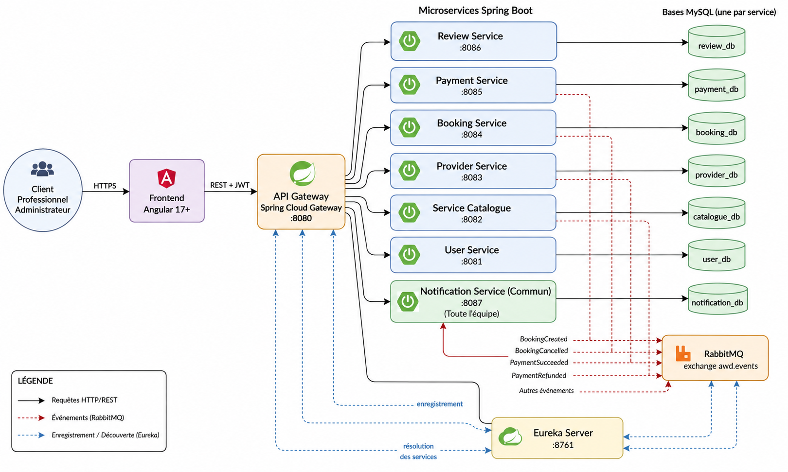<br><em>Figure 1 — Architecture microservices globale de RE’SERV</em></p>

> Le diagramme est également fourni dans `docs/diagrammes/`. Les sept microservices métier (dont le Notification Service, commun à l'équipe) possèdent chacun leur base MySQL ; le Notification Service consomme les événements publiés sur `awd.events`.

### 2.2 Composants d'infrastructure

| Composant | Rôle | Port |
|---|---|---|
| **API Gateway** (Spring Cloud Gateway) | Point d'entrée unique, routage, validation du JWT, contrôle d'accès par rôle | 8080 |
| **Eureka Server** (Discovery) | Enregistrement et découverte dynamique des instances | 8761 |
| **RabbitMQ** | Bus d'événements asynchrone, exchange `awd.events` | — |
| **MySQL** | Une base par microservice (*database per service*) | — |

### 2.3 Sécurité (JWT)

- Authentification par **JWT**, avec **Spring Security**. Le User Service authentifie l'utilisateur et émet le jeton ; le frontend le transmet à la Gateway dans l'en-tête `Authorization: Bearer <token>`.
- Le jeton porte l'identité de l'utilisateur et son rôle (`CLIENT`, `PROVIDER`, `ADMIN`) ; la Gateway le valide avant routage et les autorisations fines (ex. *Admin uniquement* pour `GET /api/bookings`) sont appliquées par rôle.
- Les codes `401 Unauthorized` (authentification requise) et `403 Forbidden` (accès interdit) sont retournés par la Gateway ou par le service concerné.

### 2.4 Données et communications

| Aspect | Choix |
|---|---|
| Persistance | MySQL, une base par service : `user_db`, `catalogue_db`, `provider_db`, `booking_db`, `payment_db`, `review_db`, `notification_db` |
| Communication synchrone | API REST (via la Gateway pour le frontend ; appels directs inter-services résolus par Eureka) |
| Communication asynchrone | RabbitMQ, exchange `awd.events`, enveloppe d'événement JSON uniforme (voir §2.5) |
| Cohérence | Cohérence à terme (*eventual consistency*) entre services, via événements ; pas de jointure inter-bases |

### 2.5 Format standard des événements

Tous les événements partagent la même enveloppe JSON :

```json
{
  "eventId": "evt-001",
  "eventType": "ProviderUpdated",
  "data": {
    "providerId": 15,
    "status": "ACTIVE",
    "city": "Tunis"
  }
}
```

| Champ | Type | Description |
|---|---|---|
| `eventId` | String | Identifiant unique de l'événement (permet l'idempotence côté consommateur) |
| `eventType` | String | Nom de l'événement (PascalCase) |
| `data` | Objet | Charge utile propre à l'événement |

### 2.6 Stack technique

| Couche | Technologie |
|---|---|
| Backend | Java 17, Spring Boot |
| API Gateway | Spring Cloud Gateway |
| Service Discovery | Eureka |
| Sécurité | Spring Security, JWT |
| Communication synchrone | API REST |
| Communication asynchrone | RabbitMQ |
| Bases de données | MySQL |
| Conteneurisation | Docker, Docker Compose |
| Frontend | Angular 17+ |
| Gestion de versions | Git, GitHub |
| Environnements de développement | IntelliJ IDEA, VS Code |
| Tests d'API | Postman |

## 3. Organisation du projet

### 3.1 Découpage en microservices et répartition de l'équipe

| Microservice | Responsable | Port | Base MySQL | Responsabilité |
|---|---|---|---|---|
| User Service | Aymen Fkir | 8081 | `user_db` | Utilisateurs, authentification et JWT |
| Service Catalogue | Khadija Bessais | 8082 | `catalogue_db` | Catégories, prestations et tarifs |
| Provider Service | Rayen Sayari | 8083 | `provider_db` | Profils, compétences, zones et disponibilités |
| Booking Service | Emna Jbari | 8084 | `booking_db` | Réservations et planning |
| Payment Service | Youssef Gomri | 8085 | `payment_db` | Paiements et remboursements |
| Review Service | Fares Ben Kheder | 8086 | `review_db` | Notes et commentaires |
| Notification Service (commun) | Toute l'équipe | 8087 | `notification_db` | Notifications aux clients et aux professionnels |
| Discovery Server (Eureka) | Toute l'équipe | 8761 | — | Découverte de services |
| API Gateway | Toute l'équipe | 8080 | — | Routage et sécurité |

Le microservice commun (Notification) est développé par toute l'équipe et présenté par un seul membre, conformément au cahier des charges. Le frontend Angular et les composants d'infrastructure (API Gateway, Eureka, Docker Compose) sont à répartir équitablement entre les membres.

### 3.2 Organisation du dépôt Git

Dépôt GitHub : `awd-platform` (l'enseignant doit y être ajouté en tant que collaborateur).

```text
awd-platform/
│
├── backend/
│   ├── discovery-server/
│   ├── api-gateway/
│   ├── user-service/
│   ├── catalogue-service/
│   ├── provider-service/
│   ├── booking-service/
│   ├── payment-service/
│   ├── review-service/
│   └── notification-service/
├── frontend/
│   └── angular-app/
├── docs/
│   ├── rapport/
│   └── diagrammes/
│
└── README.md
```

> Le dossier `docs/` contient le rapport technique, la présentation de la séance 4, le diagramme d'architecture globale et les principaux diagrammes du projet.

### 3.3 Méthodologie de gestion de projet

| Élément | Choix |
|---|---|
| Outil | GitHub Projects |
| Méthode | Tableau **Kanban** |
| Colonnes (suivi des tâches) | À faire → En cours → En revue → Terminé |
| Collaboration | Branches Git et Pull Requests (revue avant fusion) |
| Rythme | Itérations d'une semaine, suivi hebdomadaire de l'équipe |

Convention de travail : une branche par fonctionnalité (`feature/<service>-<sujet>`), une Pull Request relue par au moins un autre membre avant fusion vers `main`, une tâche du tableau par Pull Request.

### 3.4 Planning prévisionnel

Le planning prévisionnel suit des itérations d'une semaine :

| Itération | Objectifs | Livrables |
|---|---|---|
| **Itération 0 — Conception (séance 4)** | Architecture, découpage, contrats d'API, diagrammes, dépôt Git | Document technique, présentation, diagramme global |
| **Itération 1 — Socle technique** | Discovery Server, API Gateway, Docker Compose (MySQL, RabbitMQ), squelettes des services, sécurité JWT (User Service) | Environnement exécutable de bout en bout |
| **Itération 2 — Services métier (1)** | CRUD User, Catalogue, Provider ; documentation Postman | Endpoints fonctionnels et testés |
| **Itération 3 — Services métier (2)** | Booking, Payment, Review ; premiers événements RabbitMQ | Flux de réservation → paiement |
| **Itération 4 — Intégration** | Notification, interactions synchrones/asynchrones complètes, frontend Angular | Scénario complet client |
| **Itération 5 — Finalisation** | Tests, correction, Docker Compose complet, documentation finale | Livraison finale |

### 3.5 Principaux risques

| Risque | Impact | Mesure de mitigation |
|---|---|---|
| Incohérence des contrats d'API et des événements entre services | Élevé | Contrats centralisés dans ce document ; revue croisée ; enveloppe d'événement unique |
| Dépendances synchrones en chaîne (Booking → User, Catalogue, Provider) | Moyen | Timeouts, gestion du `503 Service Unavailable`, repli sur données répliquées via événements |
| Messages perdus ou rejoués (RabbitMQ) | Moyen | Files durables, `eventId` pour l'idempotence |
| Charge de travail inégale ou retard sur un service | Moyen | Suivi hebdomadaire Kanban, entraide, revue des Pull Requests |
| Complexité de l'environnement (nombreux conteneurs) | Moyen | Docker Compose unique, README d'installation |
| Sécurité (gestion du JWT, secrets) | Moyen | Secrets hors dépôt, expiration courte des jetons |

## 4. Conception détaillée des microservices

### 4.0 Conventions communes

**Codes de réponse HTTP** (communs à l'ensemble des services) :

| Code | Signification |
|---|---|
| 200 | OK – Requête réussie |
| 201 | Created – Ressource créée |
| 204 | No Content – Suppression réussie |
| 400 | Bad Request – Requête invalide |
| 401 | Unauthorized – Authentification requise |
| 403 | Forbidden – Accès interdit |
| 404 | Not Found – Ressource introuvable |
| 409 | Conflict – Conflit de données |
| 500 | Internal Server Error – Erreur serveur |
| 503 | Service Unavailable – Service indisponible |

Les codes indiqués pour chaque endpoint appliquent cette table de façon cohérente : `201` pour une création, `200` pour une lecture ou une modification, `204` pour une suppression, `400` si la requête est invalide, `401`/`403` si l'accès est refusé, `404` si la ressource est introuvable, `409` en cas de conflit, `503` si un service appelé est indisponible.

**Convention d'événements** : enveloppe `{eventId, eventType, data}` (§2.5). Les clés de routage sont en minuscules pointées (ex. `booking.completed`, `review.rating-updated`) et le `eventType` en PascalCase.

### 4.1 User Service

| | |
|---|---|
| **Responsable** | Aymen Fkir |
| **Port / Base** | 8081 / `user_db` |
| **Responsabilité** | Utilisateurs, authentification et JWT |

#### 4.1.1 Responsabilités

- Inscription, connexion et émission du jeton JWT.
- Gestion des comptes et des rôles : `CLIENT`, `PROVIDER`, `ADMIN`.
- Vérification de l'identité et du rôle à la demande des autres services.

#### 4.1.2 Données gérées

| Entité | Attributs principaux |
|---|---|
| `User` | `id` (Long), `firstName`, `lastName`, `email` (unique), `password` (haché), `phone`, `role` (Role), `status` (UserStatus), `createdAt`, `updatedAt` |
| `Role` (enum) | `CLIENT`, `PROVIDER`, `ADMIN` |
| `UserStatus` (enum) | `ACTIVE`, `INACTIVE`, `BLOCKED` |

<p align="center">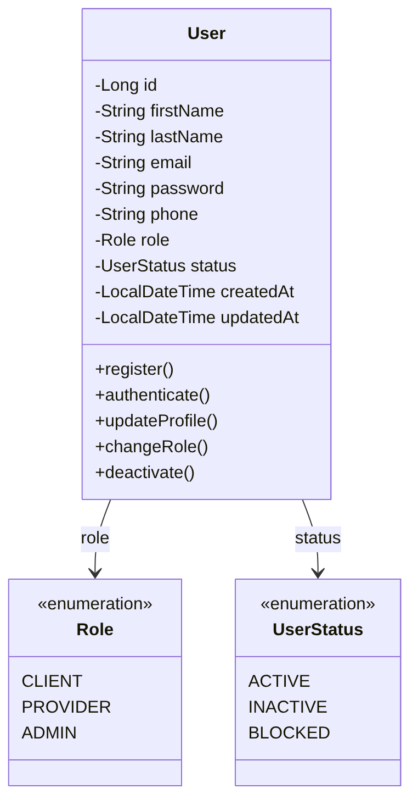<br><em>Figure 2 — Diagramme de classes du User Service</em></p>

#### 4.1.3 Endpoints REST

| Méthode | URL | Description | Codes HTTP |
|---|---|---|---|
| POST | `/api/auth/register` | Inscription (Client ou Prestataire) | 201, 400, 409 (email déjà utilisé) |
| POST | `/api/auth/login` | Connexion, retourne le JWT | 200, 400, 401 |
| GET | `/api/users` | Lister les utilisateurs (Admin) | 200, 401, 403 |
| GET | `/api/users/{id}` | Consulter un utilisateur | 200, 401, 403, 404 |
| PUT | `/api/users/{id}` | Modifier un utilisateur | 200, 400, 401, 403, 404 |
| DELETE | `/api/users/{id}` | Supprimer un utilisateur (Admin) | 204, 401, 403, 404 |
| PATCH | `/api/users/{id}/role` | Modifier le rôle (Admin) | 200, 400, 401, 403, 404 |
| PATCH | `/api/users/{id}/status` | Activer / bloquer un compte (Admin) | 200, 400, 401, 403, 404 |
| GET | `/api/users/{id}/verify` | Vérifier l'identité et le rôle (appel inter-services) | 200, 404, 503 |

**Exemple — connexion**

```json
// POST /api/auth/login — requête
{ "email": "client@reserv.tn", "password": "********" }

// 200 OK — réponse
{ "token": "<jwt>", "tokenType": "Bearer", "expiresIn": 3600, "userId": 7, "role": "CLIENT" }
```

**Exemple — vérification (appel du Booking Service)**

```json
// GET /api/users/7/verify — 200 OK
{ "userId": 7, "role": "CLIENT", "status": "ACTIVE", "valid": true }
```

#### 4.1.4 Événements RabbitMQ

| Événement | Description | Destinataires |
|---|---|---|
| `UserRegistered` | Création d'un compte | Notification |

```json
{ "eventId": "evt-201", "eventType": "UserRegistered", "data": { "userId": 7, "email": "client@reserv.tn", "role": "CLIENT" } }
```

### 4.2 Service Catalogue

| | |
|---|---|
| **Responsable** | Khadija Bessais |
| **Port / Base** | 8082 / `catalogue_db` |
| **Responsabilité** | Catégories, prestations et tarifs |

#### 4.2.1 Responsabilités

- Gérer les **catégories** et les **prestations** (nom, description, prix, durée, statut).
- Exposer le catalogue à la consultation (liste, détail, recherche par nom, filtre par prix, par catégorie).
- Notifier les autres services (Booking) de toute création, modification, désactivation ou suppression d'une prestation.
- Vérifier les droits d'administration auprès du User Service pour les opérations de gestion.

#### 4.2.2 Données gérées (diagramme de classes)

<p align="center">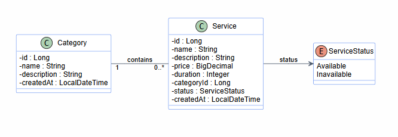<br><em>Figure 3 — Diagramme de classes du Service Catalogue</em></p>

| Entité | Attributs |
|---|---|
| `Category` | `id` : Long · `name` : String · `description` : String · `createdAt` : LocalDateTime |
| `Service` | `id` : Long · `name` : String · `description` : String · `price` : BigDecimal · `duration` : Integer · `status` : ServiceStatus · `categoryId` : Long · `createdAt` : LocalDateTime |
| `ServiceStatus` (enum) | `Available`, `Inavailable` |

#### 4.2.3 Endpoints REST (contrat d'API)

| Méthode HTTP | Endpoint | Description | Codes HTTP |
|---|---|---|---|
| POST | `/api/categories` | Créer une catégorie | 201, 400, 401, 403, 409 |
| GET | `/api/categories` | Consulter toutes les catégories | 200 |
| GET | `/api/categories/{id}` | Consulter une catégorie | 200, 404 |
| PUT | `/api/categories/{id}` | Modifier une catégorie | 200, 400, 401, 403, 404 |
| DELETE | `/api/categories/{id}` | Supprimer une catégorie | 204, 401, 403, 404, 409 |
| POST | `/api/services` | Ajouter une prestation | 201, 400, 401, 403, 404 (catégorie) |
| GET | `/api/services` | Consulter le catalogue | 200 |
| GET | `/api/services/{id}` | Consulter une prestation | 200, 404 |
| GET | `/api/services/category/{categoryId}` | Consulter les prestations par catégorie | 200, 404 |
| PUT | `/api/services/{id}` | Modifier une prestation | 200, 400, 401, 403, 404 |
| PATCH | `/api/services/{id}/status` | Activer / désactiver une prestation | 200, 400, 401, 403, 404 |
| DELETE | `/api/services/{id}` | Supprimer une prestation | 204, 401, 403, 404 |
| GET | `/api/services/search?name={name}` | Rechercher une prestation par nom | 200 |
| GET | `/api/services?minPrice={min}&maxPrice={max}` | Filtrer les prestations par prix | 200, 400 |

**Exemples de payloads**

```json
// POST /api/services — requête
{
  "name": "Coupe de cheveux",
  "description": "Coupe et mise en forme",
  "price": 25.000,
  "duration": 45,
  "categoryId": 2
}

// 201 Created — réponse
{
  "id": 3,
  "name": "Coupe de cheveux",
  "description": "Coupe et mise en forme",
  "price": 25.000,
  "duration": 45,
  "categoryId": 2,
  "status": "Available",
  "createdAt": "2026-11-15T10:30:00"
}
```

```json
// PATCH /api/services/3/status — requête
{ "status": "Inavailable" }
```

#### 4.2.4 Événements RabbitMQ

Le Service Catalogue publie des événements à destination du **Booking Service**.

| Événement | Destinataire | Description |
|---|---|---|
| `ServiceCreated` | Booking Service | Nouvelle prestation créée |
| `ServiceUpdated` | Booking Service | Prestation modifiée |
| `ServiceDesactivated` | Booking Service | Prestation désactivée |
| `ServiceDeleted` | Booking Service | Prestation supprimée |

**Formats JSON** :

```json
{ "eventId": "evt-301", "eventType": "ServiceCreated",
  "data": { "serviceId": 3, "name": "Coupe de cheveux", "price": 25.000, "duration": 45, "categoryId": 2, "status": "Available" } }
```
```json
{ "eventId": "evt-302", "eventType": "ServiceUpdated",
  "data": { "serviceId": 3, "name": "Coupe de cheveux", "price": 30.000, "duration": 45, "categoryId": 2, "status": "Available" } }
```
```json
{ "eventId": "evt-303", "eventType": "ServiceDesactivated", "data": { "serviceId": 3, "status": "Inavailable" } }
```
```json
{ "eventId": "evt-304", "eventType": "ServiceDeleted", "data": { "serviceId": 3 } }
```

#### 4.2.5 Interactions

<p align="center">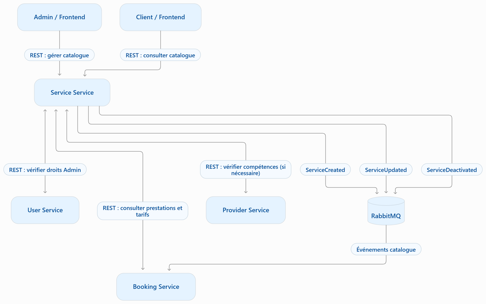<br><em>Figure 4 — Diagramme global des interactions du Service Catalogue</em></p>

- **REST sortant** : User Service (vérifier les droits Admin) ; Provider Service (vérifier les compétences, si nécessaire).
- **REST entrant** : Frontend (Admin : gérer le catalogue ; Client : consulter le catalogue) ; Booking Service (consulter prestations et tarifs).
- **Asynchrone sortant** : `ServiceCreated`, `ServiceUpdated`, `ServiceDesactivated` (et `ServiceDeleted`) vers Booking via RabbitMQ.

### 4.3 Provider Service

| | |
|---|---|
| **Responsable** | Rayen Sayari |
| **Port / Base** | 8083 / `provider_db` |
| **Responsabilité** | Profils, compétences, zones d'intervention et disponibilités |

#### 4.3.1 Conception

Le Provider Service est responsable de la gestion des professionnels de la plateforme. Il assure la gestion des **profils**, des **compétences**, des **zones d'intervention** et des **disponibilités**.

#### 4.3.2 Données gérées (diagramme de classes)

<p align="center">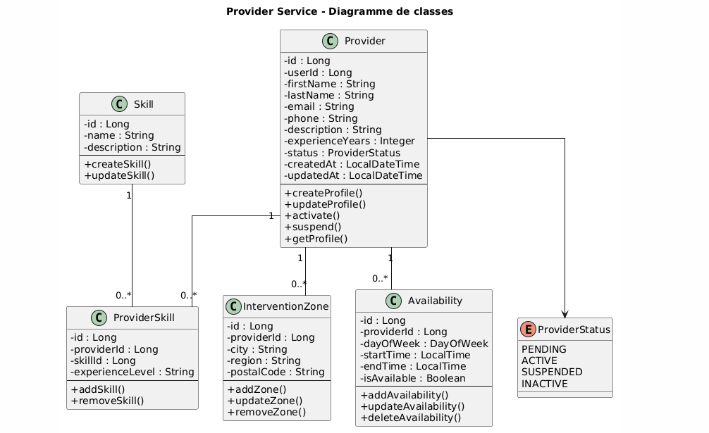<br><em>Figure 5 — Diagramme de classes du Provider Service</em></p>

| Entité | Attributs |
|---|---|
| `Provider` | `id`, `userId`, `firstName`, `lastName`, `email`, `phone`, `description`, `experienceYears` (Integer), `status` (ProviderStatus), `createdAt`, `updatedAt` |
| `Skill` | `id`, `name`, `description` |
| `ProviderSkill` | `id`, `providerId`, `skillId`, `experienceLevel` (String) |
| `InterventionZone` | `id`, `providerId`, `city`, `region`, `postalCode` |
| `Availability` | `id`, `providerId`, `dayOfWeek` (DayOfWeek), `startTime`, `endTime` (LocalTime), `isAvailable` (Boolean) |
| `ProviderStatus` (enum) | `PENDING`, `ACTIVE`, `SUSPENDED`, `INACTIVE` |

#### 4.3.3 Contrat d'API

| Méthode HTTP | Endpoint | Description | Codes HTTP |
|---|---|---|---|
| POST | `/api/providers` | Créer un professionnel | 201, 400, 401, 409 |
| GET | `/api/providers/{id}` | Consulter un professionnel | 200, 404 |
| GET | `/api/providers` | Lister les professionnels | 200 |
| PUT | `/api/providers/{id}` | Modifier un professionnel | 200, 400, 401, 403, 404 |
| DELETE | `/api/providers/{id}` | Supprimer un professionnel | 204, 401, 403, 404 |
| PATCH | `/api/providers/{id}/status` | Modifier le statut | 200, 400, 401, 403, 404 |
| POST | `/api/providers/{id}/skills` | Ajouter une compétence | 201, 400, 401, 403, 404, 409 |
| GET | `/api/providers/{id}/skills` | Consulter les compétences | 200, 404 |
| POST | `/api/providers/{id}/zones` | Ajouter une zone d'intervention | 201, 400, 401, 403, 404, 409 |
| GET | `/api/providers/{id}/zones` | Consulter les zones | 200, 404 |
| POST | `/api/providers/{id}/availabilities` | Ajouter une disponibilité | 201, 400, 401, 403, 404, 409 |
| GET | `/api/providers/{id}/availabilities` | Consulter les disponibilités | 200, 404 |
| GET | `/api/providers/search` | Rechercher des professionnels | 200, 400 |
| GET | `/api/providers/{id}/eligibility` | Vérifier l'éligibilité | 200, 404, 503 |

**Exemple de requête synchrone**

```http
GET /api/providers/15/eligibility?skillId=3&city=Tunis
```

Réponse :

```json
{
  "providerId": 15,
  "eligible": true,
  "status": "ACTIVE",
  "skillMatched": true,
  "zoneMatched": true
}
```

**Exemples de payloads**

```json
// POST /api/providers — requête
{ "userId": 42, "firstName": "Sami", "lastName": "Trabelsi", "email": "sami@reserv.tn",
  "phone": "+21620000000", "description": "Coiffeur à domicile", "experienceYears": 6 }

// POST /api/providers/15/availabilities — requête
{ "dayOfWeek": "MONDAY", "startTime": "09:00", "endTime": "17:00", "isAvailable": true }
```

#### 4.3.4 Événements RabbitMQ

Le Provider Service publie des événements pour informer les autres microservices des changements concernant les professionnels.

| Événement | Description | Destinataires |
|---|---|---|
| `ProviderCreated` | Création d'un professionnel | Booking, Review |
| `ProviderUpdated` | Modification du profil | Booking, Review |
| `ProviderActivated` | Activation du professionnel | Booking |
| `ProviderSuspended` | Suspension du professionnel | Booking, Review |
| `ProviderSkillsUpdated` | Modification des compétences | Booking |
| `ProviderZoneUpdated` | Modification des zones d'intervention | Booking |

**Exemple d'événement JSON**

```json
{
  "eventId": "evt-001",
  "eventType": "ProviderUpdated",
  "data": {
    "providerId": 15,
    "status": "ACTIVE",
    "city": "Tunis"
  }
}
```

**Formats des autres événements**

```json
{ "eventId": "evt-401", "eventType": "ProviderCreated", "data": { "providerId": 15, "userId": 42, "status": "PENDING" } }
```
```json
{ "eventId": "evt-402", "eventType": "ProviderActivated", "data": { "providerId": 15, "status": "ACTIVE" } }
```
```json
{ "eventId": "evt-403", "eventType": "ProviderSuspended", "data": { "providerId": 15, "status": "SUSPENDED" } }
```
```json
{ "eventId": "evt-404", "eventType": "ProviderSkillsUpdated", "data": { "providerId": 15, "skillIds": [3, 5] } }
```
```json
{ "eventId": "evt-405", "eventType": "ProviderZoneUpdated", "data": { "providerId": 15, "zones": [ { "city": "Tunis", "region": "Tunis", "postalCode": "1000" } ] } }
```

**Événements consommés** : `BookingConfirmed` (confirmer le créneau réservé), `BookingCancelled` (libérer le créneau) depuis le Booking Service ; `review.rating-updated` (mise à jour de la note moyenne) depuis le Review Service.

#### 4.3.5 Interactions

<p align="center">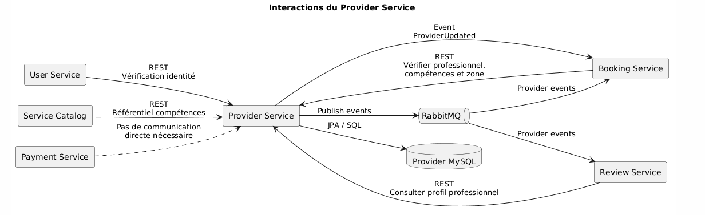<br><em>Figure 6 — Interactions du Provider Service</em></p>

- **Synchrone** : appelé par le Booking Service (vérifier et réserver un créneau) et par les services qui contrôlent l'éligibilité (`GET /api/providers/{id}/eligibility`).
- **Asynchrone** : publie les six événements ci-dessus ; consomme les événements Booking et Review.

### 4.4 Booking Service

| | |
|---|---|
| **Responsable** | Emna Jbari |
| **Port / Base** | 8084 / `booking_db` |
| **Responsabilité** | Réservations et planning |

#### 4.4.1 Responsabilités

- Créer, consulter, modifier et annuler des réservations.
- Orchestrer la validation d'une réservation : identité (User), prestation et tarif (Catalogue), créneau (Provider).
- Gérer le cycle de vie d'une réservation et son historique de statuts.
- Fournir le planning des réservations d'un professionnel et d'un client.
- Réagir au résultat du paiement et notifier les autres services par événements.

#### 4.4.2 Données gérées (diagramme de classes)

<p align="center">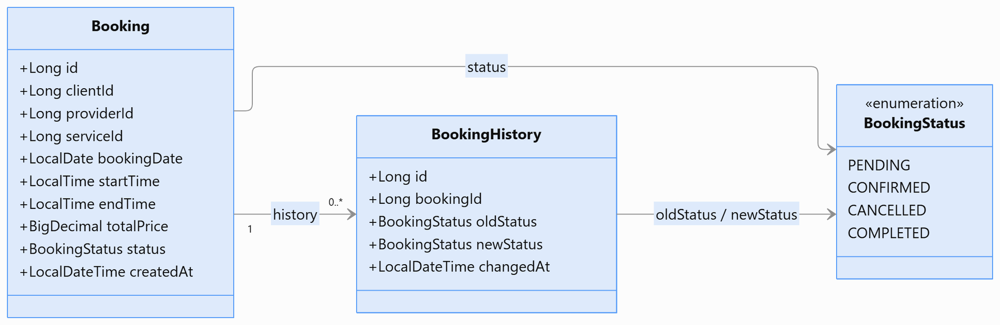<br><em>Figure 7 — Diagramme de classes du Booking Service</em></p>

| Entité | Attributs |
|---|---|
| `Booking` | `id`, `clientId`, `providerId`, `serviceId` (Long) · `bookingDate` (LocalDate) · `startTime`, `endTime` (LocalTime) · `totalPrice` (BigDecimal) · `status` (BookingStatus) · `createdAt` (LocalDateTime) |
| `BookingHistory` | `id`, `bookingId` (Long) · `oldStatus`, `newStatus` (BookingStatus) · `changedAt` (LocalDateTime) |
| `BookingStatus` (enum) | `PENDING`, `CONFIRMED`, `CANCELLED`, `COMPLETED` |

**Cycle de vie** : `PENDING` → `CONFIRMED` (paiement réussi) → `COMPLETED` (prestation réalisée) ; `PENDING` ou `CONFIRMED` → `CANCELLED`.

#### 4.4.3 Endpoints REST

| Méthode HTTP | Endpoint | Description | Codes HTTP |
|---|---|---|---|
| POST | `/api/bookings` | Créer une réservation | 201, 400, 401, 403, 404, 409 (créneau indisponible), 503 |
| GET | `/api/bookings` | Consulter toutes les réservations (Admin) | 200, 401, 403 |
| GET | `/api/bookings/{id}` | Consulter une réservation | 200, 401, 403, 404 |
| GET | `/api/bookings/client/{clientId}` | Consulter les réservations d'un client | 200, 401, 403 |
| GET | `/api/bookings/provider/{providerId}` | Consulter les réservations d'un professionnel | 200, 401, 403 |
| PUT | `/api/bookings/{id}` | Modifier une réservation | 200, 400, 401, 403, 404, 409 |
| PATCH | `/api/bookings/{id}/cancel` | Annuler une réservation | 200, 401, 403, 404, 409 (déjà annulée / réalisée) |
| GET | `/api/bookings/provider/{providerId}/planning` | Consulter le planning des réservations d'un professionnel | 200, 401, 403, 404 |
| GET | `/api/bookings/client/{clientId}/planning` | Consulter le planning des réservations d'un client | 200, 401, 403, 404 |

**Exemples de payloads**

```json
// POST /api/bookings — requête (Authorization: Bearer <jwt>)
{ "clientId": 7, "providerId": 15, "serviceId": 3,
  "bookingDate": "2026-12-02", "startTime": "10:00", "endTime": "10:45" }

// 201 Created — réponse
{ "id": 42, "clientId": 7, "providerId": 15, "serviceId": 3,
  "bookingDate": "2026-12-02", "startTime": "10:00", "endTime": "10:45",
  "totalPrice": 25.000, "status": "PENDING", "createdAt": "2026-11-15T10:35:00" }
```

#### 4.4.4 Événements RabbitMQ

| Événement | Destinataire | Description |
|---|---|---|
| `BookingCreated` | Payment Service, Notification Service | Déclencher le paiement et informer les parties concernées |
| `BookingConfirmed` | Provider Service, Notification Service | Confirmer le créneau réservé et informer le client et le professionnel |
| `BookingCancelled` | Provider Service, Payment Service, Notification Service | Libérer le créneau, examiner un éventuel remboursement et informer les parties concernées |
| `BookingCompleted` | Review Service, Notification Service | Autoriser l'évaluation de la prestation et inviter le client à donner son avis |

**Formats JSON**

```json
{ "eventId": "evt-501", "eventType": "BookingCreated",
  "data": { "bookingId": 42, "clientId": 7, "providerId": 15, "serviceId": 3,
            "bookingDate": "2026-12-02", "startTime": "10:00", "endTime": "10:45",
            "totalPrice": 25.000, "status": "PENDING" } }
```
```json
{ "eventId": "evt-502", "eventType": "BookingConfirmed",
  "data": { "bookingId": 42, "providerId": 15, "bookingDate": "2026-12-02",
            "startTime": "10:00", "endTime": "10:45", "status": "CONFIRMED" } }
```
```json
{ "eventId": "evt-503", "eventType": "BookingCancelled",
  "data": { "bookingId": 42, "clientId": 7, "providerId": 15, "totalPrice": 25.000,
            "status": "CANCELLED", "reason": "Annulation par le client" } }
```
```json
{ "eventId": "evt-504", "eventType": "BookingCompleted",
  "data": { "bookingId": 42, "clientId": 7, "providerId": 15, "serviceId": 3, "status": "COMPLETED" } }
```

**Événements consommés** : `PaymentSucceeded` / `PaymentFailed` (Payment Service) ; `ServiceCreated`, `ServiceUpdated`, `ServiceDesactivated`, `ServiceDeleted` (Catalogue) ; événements Provider (`ProviderCreated`, `ProviderUpdated`, `ProviderActivated`, `ProviderSuspended`, `ProviderSkillsUpdated`, `ProviderZoneUpdated`).

#### 4.4.5 Interactions

<p align="center">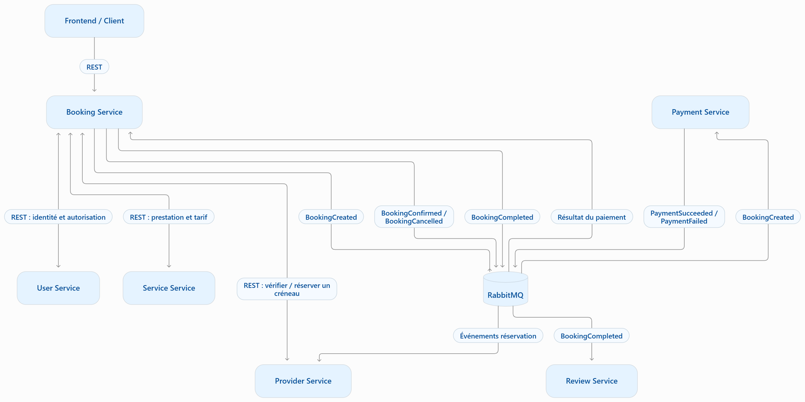<br><em>Figure 8 — Architecture des communications du Booking Service</em></p>

- **REST sortant** : User Service (identité et autorisation), Service Catalogue (prestation et tarif), Provider Service (vérifier / réserver un créneau).
- **Asynchrone** : publie les quatre événements ci-dessus ; consomme le résultat du paiement et les événements Catalogue et Provider.

### 4.5 Payment Service

| | |
|---|---|
| **Responsable** | Youssef Gomri |
| **Port / Base** | 8085 / `payment_db` |
| **Responsabilité** | Paiements, remboursements et factures |

#### 4.5.1 Responsabilités

- Traiter le paiement en ligne d'une réservation dès réception de l'événement `BookingCreated`.
- Publier le résultat du paiement (`PaymentSucceeded` ou `PaymentFailed`), consommé par le Booking Service pour confirmer la réservation.
- Rembourser une réservation annulée (`BookingCancelled`) ou sur demande, et publier `PaymentRefunded`.
- Générer et fournir les factures associées aux paiements.
- Garantir l'unicité d'un paiement par réservation et traiter les événements de façon idempotente (`eventId`).

#### 4.5.2 Données gérées (diagramme de classes)

<p align="center">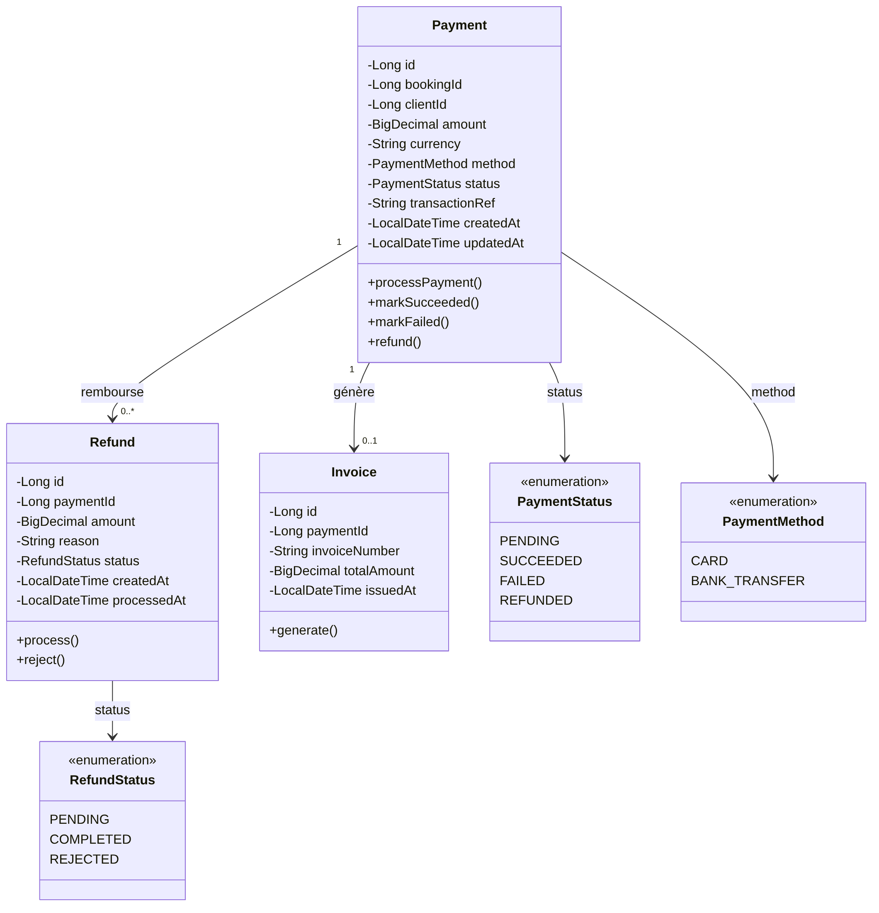<br><em>Figure 9 — Diagramme de classes du Payment Service</em></p>

| Entité | Attributs |
|---|---|
| `Payment` | `id`, `bookingId`, `clientId` (Long) · `amount` (BigDecimal) · `currency` (String) · `method` (PaymentMethod) · `status` (PaymentStatus) · `transactionRef` (String) · `createdAt`, `updatedAt` (LocalDateTime) |
| `Refund` | `id`, `paymentId` (Long) · `amount` (BigDecimal) · `reason` (String) · `status` (RefundStatus) · `createdAt`, `processedAt` (LocalDateTime) |
| `Invoice` | `id`, `paymentId` (Long) · `invoiceNumber` (String) · `totalAmount` (BigDecimal) · `issuedAt` (LocalDateTime) |
| `PaymentStatus` (enum) | `PENDING`, `SUCCEEDED`, `FAILED`, `REFUNDED` |
| `PaymentMethod` (enum) | `CARD`, `BANK_TRANSFER` |
| `RefundStatus` (enum) | `PENDING`, `COMPLETED`, `REJECTED` |

#### 4.5.3 Endpoints REST

| Méthode HTTP | Endpoint | Description | Codes HTTP |
|---|---|---|---|
| POST | `/api/payments` | Initier un paiement pour une réservation | 201, 400, 401, 404, 409 (déjà payée) |
| GET | `/api/payments` | Consulter tous les paiements (Admin) | 200, 401, 403 |
| GET | `/api/payments/{id}` | Consulter un paiement | 200, 401, 403, 404 |
| GET | `/api/payments/booking/{bookingId}` | Consulter le paiement d'une réservation | 200, 401, 403, 404 |
| GET | `/api/payments/client/{clientId}` | Consulter les paiements d'un client | 200, 401, 403 |
| POST | `/api/payments/{id}/refund` | Demander un remboursement | 201, 400, 401, 403, 404, 409 (déjà remboursé) |
| GET | `/api/payments/{id}/refunds` | Consulter les remboursements d'un paiement | 200, 401, 403, 404 |
| GET | `/api/payments/{id}/invoice` | Obtenir la facture d'un paiement | 200, 401, 403, 404 |

**Exemples de payloads**

```json
// POST /api/payments — requête
{ "bookingId": 42, "clientId": 7, "amount": 25.000, "currency": "TND", "method": "CARD" }

// 201 Created — réponse
{ "id": 9, "bookingId": 42, "clientId": 7, "amount": 25.000, "currency": "TND",
  "method": "CARD", "status": "PENDING", "createdAt": "2026-11-15T10:36:00" }
```
```json
// POST /api/payments/9/refund — requête
{ "amount": 25.000, "reason": "Annulation par le client" }

// 201 Created — réponse
{ "id": 3, "paymentId": 9, "amount": 25.000, "reason": "Annulation par le client", "status": "PENDING" }
```

#### 4.5.4 Événements RabbitMQ

| Événement | Sens | Destinataires / Source | Description |
|---|---|---|---|
| `BookingCreated` | Consommé | Booking Service | Déclenche le traitement du paiement |
| `BookingCancelled` | Consommé | Booking Service | Déclenche l'examen d'un éventuel remboursement |
| `PaymentSucceeded` | Publié | Booking Service, Notification Service | Paiement réussi : la réservation passe à `CONFIRMED` |
| `PaymentFailed` | Publié | Booking Service, Notification Service | Paiement refusé |
| `PaymentRefunded` | Publié | Notification Service | Remboursement effectué |

**Formats JSON**

```json
{ "eventId": "evt-601", "eventType": "PaymentSucceeded",
  "data": { "paymentId": 9, "bookingId": 42, "clientId": 7, "amount": 25.000, "currency": "TND", "status": "SUCCEEDED" } }
```
```json
{ "eventId": "evt-602", "eventType": "PaymentFailed",
  "data": { "paymentId": 9, "bookingId": 42, "clientId": 7, "status": "FAILED", "reason": "Paiement refusé" } }
```
```json
{ "eventId": "evt-603", "eventType": "PaymentRefunded",
  "data": { "refundId": 3, "paymentId": 9, "bookingId": 42, "clientId": 7, "amount": 25.000, "status": "REFUNDED" } }
```

#### 4.5.5 Interactions

- **Asynchrone uniquement** : le Payment Service reçoit `BookingCreated` et `BookingCancelled` du Booking Service, et lui renvoie le résultat du paiement ; il n'appelle aucun autre service en REST (voir §5.7 et §5.8).
- **REST entrant** : Frontend, via l'API Gateway (consultation des paiements, factures, demande de remboursement).

### 4.6 Review Service

| | |
|---|---|
| **Responsable** | Fares Ben Kheder |
| **Port / Base** | 8086 / `review_db` |
| **Responsabilité** | Notes, commentaires et moyenne des professionnels |

#### 4.6.1 Conception

Le Review Service gère les avis des clients sur les professionnels : **note de 1 à 5**, **commentaire** et **moyenne**. Un avis n'est possible qu'**après une prestation réalisée**.

- À la réception de `booking.completed`, le service enregistre une réservation évaluable (`ReviewableBooking`) qui autorise l'avis correspondant.
- À chaque avis publié, masqué ou supprimé, la note moyenne du professionnel est recalculée (`ProviderRatingSummary`) et publiée via `review.rating-updated`.
- Le service n'a **aucune communication directe** avec le User Service, le Service Catalogue et le Payment Service.

#### 4.6.2 Données gérées (diagramme de classes)

<p align="center">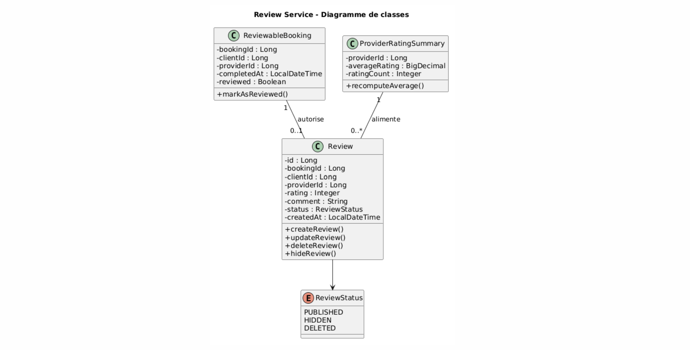<br><em>Figure 10 — Diagramme de classes du Review Service</em></p>

| Entité | Attributs |
|---|---|
| `Review` | `id`, `bookingId`, `clientId`, `providerId` (Long) · `rating` (Integer, 1 à 5) · `comment` (String) · `status` (ReviewStatus) · `createdAt` (LocalDateTime) · méthodes : `createReview()`, `updateReview()`, `deleteReview()`, `hideReview()` |
| `ReviewableBooking` | `bookingId`, `clientId`, `providerId` (Long) · `completedAt` (LocalDateTime) · `reviewed` (Boolean) · méthode : `markAsReviewed()` |
| `ProviderRatingSummary` | `providerId` (Long) · `averageRating` (BigDecimal) · `ratingCount` (Integer) · méthode : `recomputeAverage()` |
| `ReviewStatus` (enum) | `PUBLISHED`, `HIDDEN`, `DELETED` |

Relations : une `ReviewableBooking` autorise au plus un `Review` (cardinalité 1 — 0..1) ; un `ProviderRatingSummary` est alimenté par 0..* `Review`.

Règles de gestion : une seule note par réservation (`409 Conflict` — avis déjà publié) ; note comprise entre 1 et 5 (`400` sinon) ; avis accepté uniquement si la réservation est terminée et appartient au client authentifié (`403` sinon).

#### 4.6.3 Endpoints REST

Le Review Service est accessible par le frontend via l'API Gateway (publication et consultation des avis).

| Méthode HTTP | Endpoint | Description | Codes HTTP |
|---|---|---|---|
| POST | `/api/reviews` | Publier un avis (après prestation réalisée) | 201, 400, 401, 403, 409 |
| GET | `/api/reviews/{id}` | Consulter un avis | 200, 404 |
| GET | `/api/reviews/provider/{providerId}` | Consulter les avis d'un professionnel | 200, 404 |
| GET | `/api/reviews/provider/{providerId}/summary` | Consulter la note moyenne et le nombre d'avis | 200, 404 |
| GET | `/api/reviews/client/{clientId}` | Consulter les avis publiés par un client | 200, 401, 403 |
| GET | `/api/reviews/booking/{bookingId}/eligibility` | Vérifier si une réservation peut être évaluée | 200, 401, 404 |
| PUT | `/api/reviews/{id}` | Modifier son avis | 200, 400, 401, 403, 404 |
| DELETE | `/api/reviews/{id}` | Supprimer un avis (statut `DELETED`) | 204, 401, 403, 404 |
| PATCH | `/api/reviews/{id}/hide` | Masquer un avis (Admin, statut `HIDDEN`) | 200, 401, 403, 404 |

**Codes de réponse HTTP spécifiques au service**

| Code | Signification |
|---|---|
| 200 | OK – Requête réussie |
| 201 | Created – Avis créé |
| 204 | No Content – Suppression réussie |
| 400 | Bad Request – Requête invalide |
| 403 | Forbidden – Accès interdit |
| 404 | Not Found – Ressource introuvable |
| 409 | Conflict – Avis déjà publié |

**Exemples de payloads**

```json
// POST /api/reviews — requête
{ "bookingId": 42, "providerId": 15, "rating": 5, "comment": "Prestation impeccable et ponctuelle." }

// 201 Created — réponse
{ "id": 11, "bookingId": 42, "clientId": 7, "providerId": 15, "rating": 5,
  "comment": "Prestation impeccable et ponctuelle.", "status": "PUBLISHED", "createdAt": "2026-12-02T12:00:00" }
```
```json
// GET /api/reviews/provider/15/summary — 200 OK
{ "providerId": 15, "averageRating": 4.6, "ratingCount": 23 }
```

#### 4.6.4 Événements RabbitMQ

| Événement | Sens | Source / Destinataire | Description |
|---|---|---|---|
| `booking.completed` | Consommé | Booking Service (exchange `awd.events`) | Prestation réalisée : crée la `ReviewableBooking` et autorise l'avis |
| `review.rating-updated` | Publié | Provider Service | Mise à jour de la note moyenne du professionnel |

Le Review Service consomme aussi les événements du Provider Service qui le concernent (`ProviderCreated`, `ProviderUpdated`, `ProviderSuspended`).

**Format JSON**

```json
{ "eventId": "evt-701", "eventType": "ReviewRatingUpdated",
  "data": { "providerId": 15, "averageRating": 4.6, "ratingCount": 23 } }
```

#### 4.6.5 Interactions

<p align="center">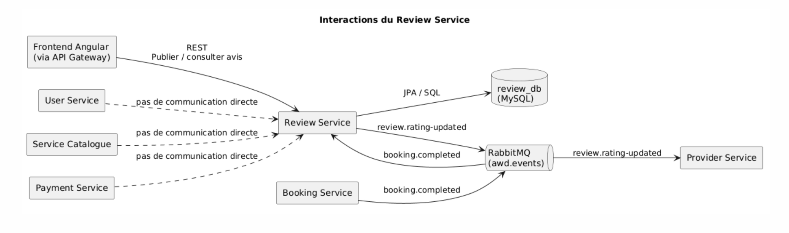<br><em>Figure 11 — Interactions du Review Service</em></p>

- **REST** : Frontend Angular (via l'API Gateway) pour publier et consulter les avis ; persistance JPA / SQL dans `review_db` (MySQL).
- **Asynchrone** : consomme `booking.completed` ; publie `review.rating-updated` vers le Provider Service.
- **Aucune communication directe** avec User Service, Service Catalogue et Payment Service.

### 4.7 Notification Service (microservice commun)

| | |
|---|---|
| **Responsable** | Toute l'équipe (présenté par un seul membre) |
| **Port / Base** | 8087 / `notification_db` |
| **Responsabilité** | Notifications aux clients et aux professionnels |

#### 4.7.1 Responsabilités

- Informer les clients et les professionnels des événements importants : réservation créée, confirmée, annulée ou terminée ; paiement réussi, refusé ou remboursé ; création de compte.
- Consommer les événements publiés sur l'exchange `awd.events` ; le service ne publie aucun événement.
- Conserver l'historique des notifications d'un utilisateur et permettre de les consulter, de les marquer comme lues ou de les supprimer.
- Éviter les doublons en mémorisant l'`eventId` de chaque événement traité (idempotence).

#### 4.7.2 Données gérées (diagramme de classes)

<p align="center">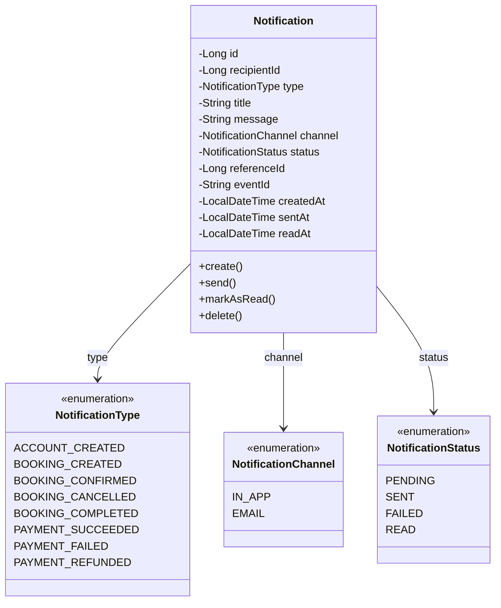<br><em>Figure 12 — Diagramme de classes du Notification Service</em></p>

| Entité | Attributs |
|---|---|
| `Notification` | `id`, `recipientId`, `referenceId` (Long) · `type` (NotificationType) · `title`, `message` (String) · `channel` (NotificationChannel) · `status` (NotificationStatus) · `eventId` (String, unique) · `createdAt`, `sentAt`, `readAt` (LocalDateTime) |
| `NotificationType` (enum) | `ACCOUNT_CREATED`, `BOOKING_CREATED`, `BOOKING_CONFIRMED`, `BOOKING_CANCELLED`, `BOOKING_COMPLETED`, `PAYMENT_SUCCEEDED`, `PAYMENT_FAILED`, `PAYMENT_REFUNDED` |
| `NotificationChannel` (enum) | `IN_APP`, `EMAIL` |
| `NotificationStatus` (enum) | `PENDING`, `SENT`, `FAILED`, `READ` |

`recipientId` désigne l'identifiant de l'utilisateur destinataire ; `referenceId` désigne la réservation ou le paiement concerné.

#### 4.7.3 Endpoints REST

| Méthode HTTP | Endpoint | Description | Codes HTTP |
|---|---|---|---|
| GET | `/api/notifications` | Consulter toutes les notifications (Admin) | 200, 401, 403 |
| GET | `/api/notifications/{id}` | Consulter une notification | 200, 401, 403, 404 |
| GET | `/api/notifications/user/{userId}` | Consulter les notifications d'un utilisateur | 200, 401, 403 |
| GET | `/api/notifications/user/{userId}/unread-count` | Obtenir le nombre de notifications non lues | 200, 401, 403 |
| PATCH | `/api/notifications/{id}/read` | Marquer une notification comme lue | 200, 401, 403, 404 |
| PATCH | `/api/notifications/user/{userId}/read-all` | Marquer toutes les notifications comme lues | 200, 401, 403 |
| DELETE | `/api/notifications/{id}` | Supprimer une notification | 204, 401, 403, 404 |

```json
// GET /api/notifications/user/7 — 200 OK
[
  { "id": 21, "recipientId": 7, "type": "PAYMENT_SUCCEEDED", "title": "Paiement confirmé",
    "message": "Votre paiement de 25.000 TND pour la réservation n°42 a bien été reçu.",
    "channel": "IN_APP", "status": "SENT", "referenceId": 42, "createdAt": "2026-11-15T10:37:00" }
]
```

#### 4.7.4 Événements RabbitMQ consommés

| Événement | Producteur | Notification générée | Destinataire(s) |
|---|---|---|---|
| `UserRegistered` | User Service | Bienvenue sur la plateforme | Utilisateur concerné |
| `BookingCreated` | Booking Service | Réservation en attente de paiement / nouvelle demande de réservation | Client, professionnel |
| `BookingConfirmed` | Booking Service | Réservation confirmée | Client, professionnel |
| `BookingCancelled` | Booking Service | Réservation annulée | Client, professionnel |
| `BookingCompleted` | Booking Service | Prestation réalisée : invitation à donner son avis | Client |
| `PaymentSucceeded` | Payment Service | Paiement confirmé | Client |
| `PaymentFailed` | Payment Service | Paiement refusé | Client |
| `PaymentRefunded` | Payment Service | Remboursement effectué | Client |

#### 4.7.5 Interactions

- **Asynchrone** : consommateur des événements Booking, Payment et User (voir §5.1) ; aucun événement publié.
- **REST sortant** : User Service (`GET /api/users/{id}`) pour obtenir les coordonnées d'un client ; Provider Service (`GET /api/providers/{id}`) pour celles d'un professionnel.
- **REST entrant** : Frontend, via l'API Gateway (consultation des notifications).

## 5. Synthèse des interactions

### 5.1 Matrice des événements RabbitMQ (exchange `awd.events`)

| Événement | Producteur | Consommateurs |
|---|---|---|
| `ServiceCreated`, `ServiceUpdated`, `ServiceDesactivated`, `ServiceDeleted` | Service Catalogue | Booking |
| `ProviderCreated` | Provider | Booking, Review |
| `ProviderUpdated` | Provider | Booking, Review |
| `ProviderActivated` | Provider | Booking |
| `ProviderSuspended` | Provider | Booking, Review |
| `ProviderSkillsUpdated`, `ProviderZoneUpdated` | Provider | Booking |
| `BookingCreated` | Booking | Payment, Notification |
| `BookingConfirmed` | Booking | Provider, Notification |
| `BookingCancelled` | Booking | Provider, Payment, Notification |
| `BookingCompleted` | Booking | Review, Notification |
| `PaymentSucceeded`, `PaymentFailed` | Payment | Booking, Notification |
| `PaymentRefunded` | Payment | Notification |
| `review.rating-updated` | Review | Provider |
| `UserRegistered` | User | Notification |

### 5.2 Matrice des appels synchrones (REST)

| Appelant | Appelé | Objet |
|---|---|---|
| Frontend | API Gateway → tous les services | Toutes les opérations (REST + JWT) |
| Booking | User | Vérifier l'identité et le rôle |
| Booking | Catalogue | Vérifier la prestation et le tarif |
| Booking | Provider | Vérifier et réserver le créneau |
| Catalogue | User | Vérifier les droits Admin |
| Catalogue | Provider | Vérifier les compétences (si nécessaire) |
| Services concernés | Provider | `GET /api/providers/{id}/eligibility` |
| Notification | User | Obtenir les coordonnées d'un client |
| Notification | Provider | Obtenir les coordonnées d'un professionnel |

### 5.3 Flux synchrone n°1 — Consultation d'une prestation

Le client sélectionne une prestation ; le frontend interroge le Catalogue via la Gateway.

<p align="center">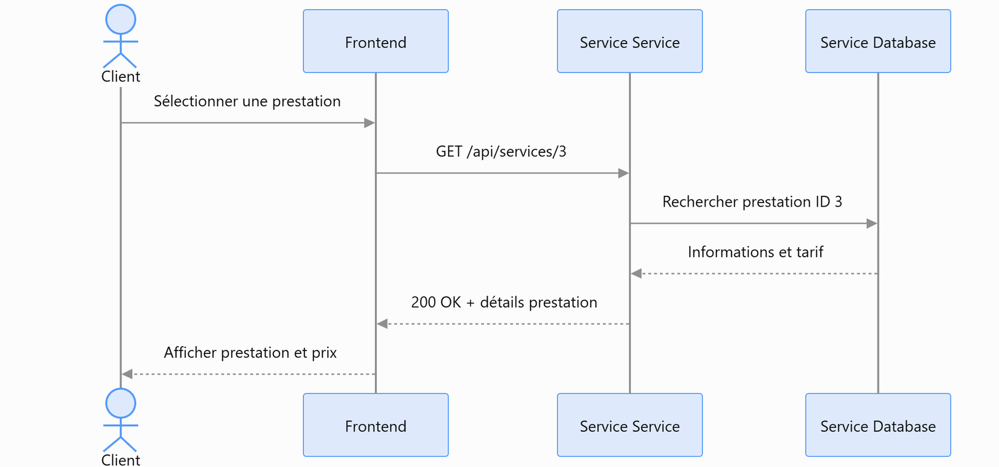<br><em>Figure 13 — Communication synchrone : consultation d'une prestation</em></p>

### 5.4 Flux synchrone n°2 — Création d'une réservation

<p align="center">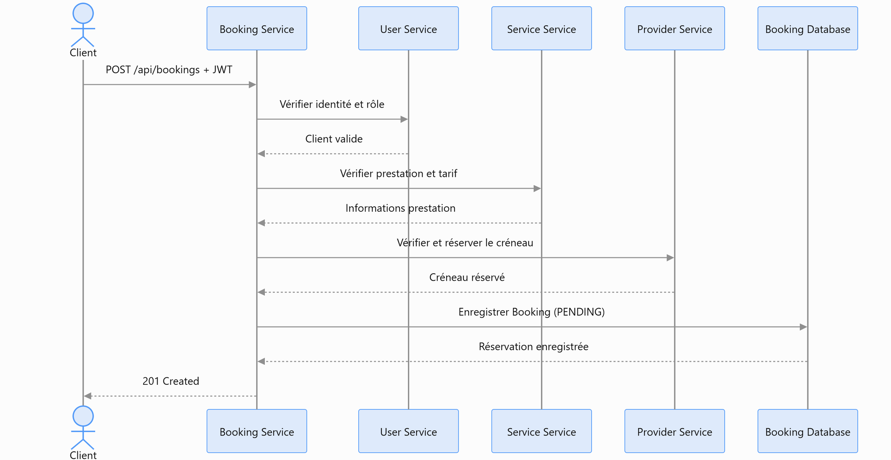<br><em>Figure 14 — Communication synchrone : création d'une réservation</em></p>

Si un service appelé est indisponible, le Booking Service retourne `503 Service Unavailable` ; si le créneau est déjà pris, `409 Conflict`.

### 5.5 Flux synchrone n°3 — Vérification d'éligibilité d'un professionnel

Requête : `GET /api/providers/15/eligibility?skillId=3&city=Tunis`

```json
{
  "providerId": 15,
  "eligible": true,
  "status": "ACTIVE",
  "skillMatched": true,
  "zoneMatched": true
}
```

### 5.6 Flux asynchrone n°1 — Modification d'une prestation

<p align="center">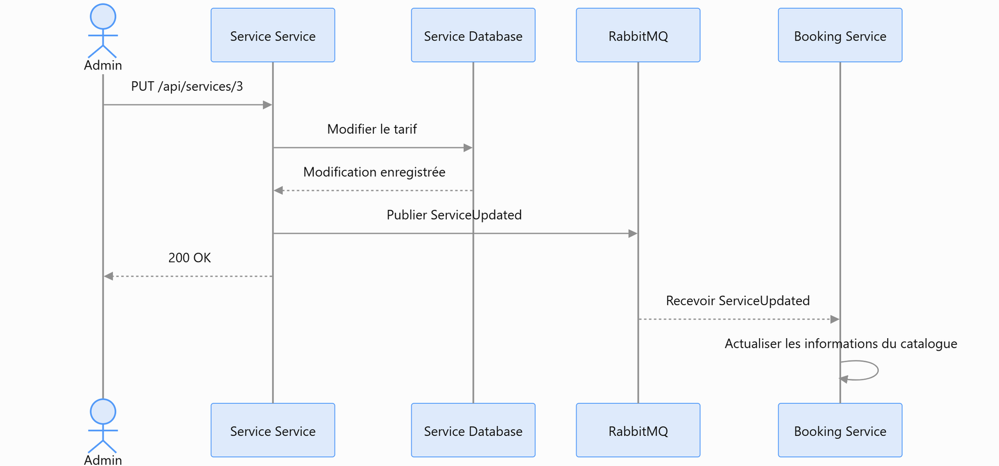<br><em>Figure 15 — Communication asynchrone : modification d'une prestation</em></p>

L'administrateur reçoit sa réponse sans attendre le traitement côté Booking : le couplage entre services est réduit.

### 5.7 Flux asynchrone n°2 — Confirmation du paiement

<p align="center">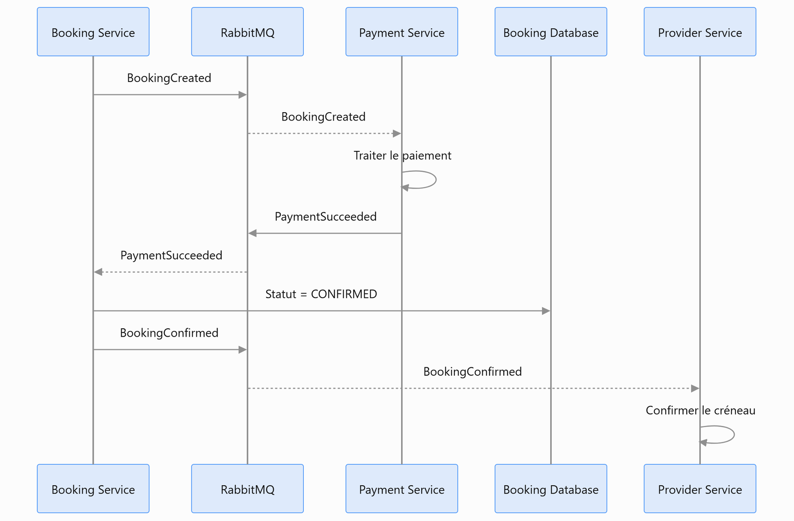<br><em>Figure 16 — Communication asynchrone : confirmation du paiement</em></p>

En cas d'échec, `PaymentFailed` est publié : le Booking Service peut annuler la réservation en attente et le créneau est libéré (`BookingCancelled`).

### 5.8 Flux asynchrone n°3 — Annulation et remboursement

<p align="center">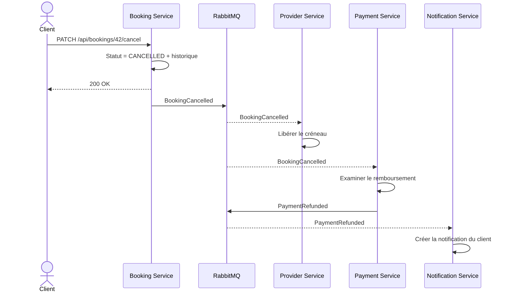<br><em>Figure 17 — Communication asynchrone : annulation et remboursement</em></p>

1. Le client appelle `PATCH /api/bookings/42/cancel` ; le Booking Service passe la réservation à `CANCELLED`, enregistre l'historique et publie `BookingCancelled`.
2. Le Provider Service libère le créneau ; le Payment Service examine le remboursement et publie `PaymentRefunded` si nécessaire.
3. Le Notification Service informe le client et le professionnel.

### 5.9 Flux asynchrone n°4 — Prestation réalisée et avis

1. Le Booking Service publie `BookingCompleted` ; le Review Service l'enregistre et autorise l'avis.
2. Le client publie son avis (`POST /api/reviews`).
3. Le Review Service recalcule la moyenne et publie `review.rating-updated` ; le Provider Service met à jour la note du professionnel.

### 5.10 Flux asynchrone n°5 — Génération d'une notification

<p align="center">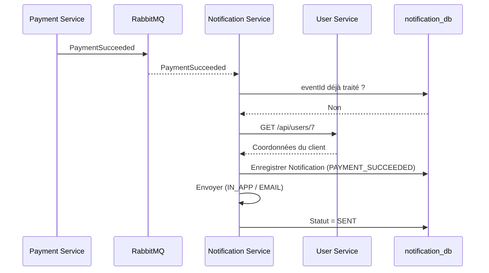<br><em>Figure 18 — Communication asynchrone : notification d'un paiement réussi</em></p>

Le Notification Service consomme `PaymentSucceeded`, vérifie que l'événement n'a pas déjà été traité (`eventId`), récupère les coordonnées du client auprès du User Service, enregistre la notification puis l'envoie (in-app ou e-mail). Le même mécanisme s'applique aux autres événements listés au §4.7.4.
